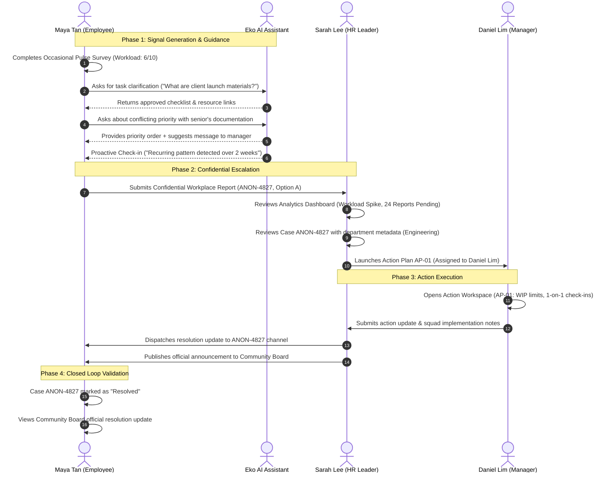
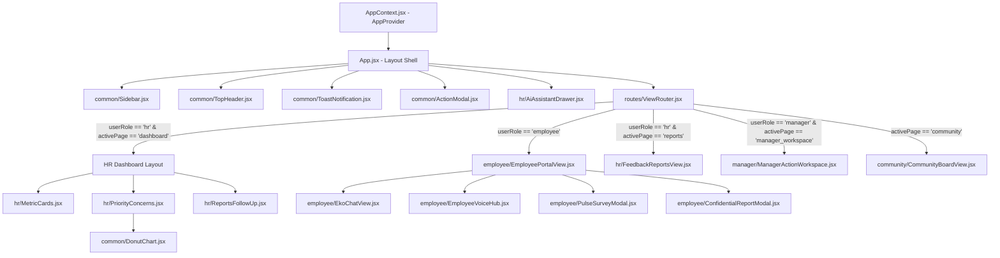
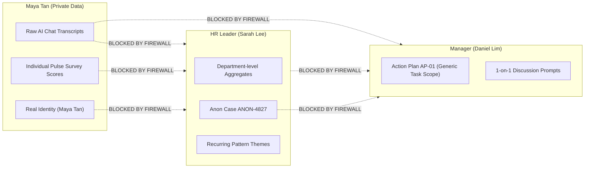

# EchoHR — Architecture, Code Structure & Developer Guide

> **EchoHR** is an AI-powered People Intelligence and Employee Voice platform designed for early detection of employee disengagement, workload imbalances, and workplace friction, while enforcing strict privacy-by-design standards across organizational roles.

---

## Table of Contents

1. [Executive Summary & Product Context](#1-executive-summary--product-context)
2. [Technology Stack & Build Tooling](#2-technology-stack--build-tooling)
3. [System Architecture & Multi-Role Feedback Loop](#3-system-architecture--multi-role-feedback-loop)
4. [Directory & File Structure](#4-directory--file-structure)
5. [Component Architecture & View Routing](#5-component-architecture--view-routing)
6. [Data Models & Schema Reference](#6-data-models--schema-reference)
7. [State Management & Data Flow](#7-state-management--data-flow)
8. [Design System & Styling Patterns](#8-design-system--styling-patterns)
9. [Privacy-by-Design & Access Boundaries](#9-privacy-by-design--access-boundaries)
10. [Developer Onboarding & Extension Guide](#10-developer-onboarding--extension-guide)

---

## 1. Executive Summary & Product Context

### The Problem
Traditional employee surveys (annual or quarterly) suffer from high latency, low response trust, and lack of actionable context. Employees facing workload stress or role ambiguity often fear retaliation or being viewed as incompetent. Consequently, disengagement and burnout manifest before HR or leadership can intervene.

### The EchoHR Solution
EchoHR bridges the communication gap through a **tri-role ecosystem**:

1. **Employee (Maya Tan, Junior Software Engineer)**:
   - Conversational AI assistant (**Eko**) for safe, non-judgmental guidance and task prioritization.
   - Occasional low-friction pulse survey with sliders.
   - Confidential reporting with configurable privacy levels (Department-level vs. 100% Anonymous).
   - Peer Community Board with anonymous discussions and upvotes.
2. **HR Leader (Sarah Lee, Lead People Partner)**:
   - Macroscopic People Intelligence dashboard tracking company-wide & departmental sentiment.
   - Early signal aggregation (Eko recurring pattern detection, pulse drop metrics).
   - Case resolution workflow: assigning anonymized action plans to managers without breaking employee confidentiality.
   - Broadcast capability for company-wide updates to the Community Board.
3. **Engineering Manager (Daniel Lim, Platform Squad Manager)**:
   - Mode 1 Manager Action Workspace: Receives actionable, scoped interventions (e.g., Action Plan `AP-01`).
   - Never sees individual employee identities, individual pulse ratings, or raw private AI chats.
   - Access to AI-assisted 1-on-1 coaching prompts to lead constructive team conversations.

---

## 2. Technology Stack & Build Tooling

### Core Framework & Runtime
| Technology | Version | Purpose |
| :--- | :--- | :--- |
| **Node.js** | `>= 18.x` | JavaScript runtime environment |
| **React** | `^19.3.1` | UI library utilizing functional components and React Hooks (`useState`, `useEffect`, `useRef`, `useMemo`) |
| **React DOM** | `^19.3.1` | DOM renderer for React |
| **Vite** | `^6.0.0` | Next-generation frontend tooling and HMR dev server |
| **@vitejs/plugin-react** | `^4.7.0` | Official Babel/Fast Refresh plugin for React in Vite |

### Styling & Design System
| Technology | Version | Purpose |
| :--- | :--- | :--- |
| **Tailwind CSS** | `^3.4.19` | Utility-first CSS framework with tailored tokens |
| **PostCSS** | `^8.5.31` | CSS processor for Tailwind and Autoprefixer |
| **Autoprefixer** | `^10.6.1` | Vendor prefix parser |
| **Lucide React** | `^1.59.0` | Accessible, tree-shakeable SVG icon collection |
| **Google Fonts (Plus Jakarta Sans)** | `400-800` | Modern, clean geometric sans-serif typography |

### Deployment & Hosting Config
- **`vercel.json`**: Configured for single-page application routing (`rewrites: [{ source: "/(.*)", destination: "/index.html" }]`).

---

## 3. System Architecture & Multi-Role Feedback Loop

EchoHR operates as an event-driven client-side application where state is lifted to [App.jsx](file:///c:/Users/Crystal%20Yap/Desktop/AIFM/src/App.jsx) to coordinate synchronous updates across all three user personas.

### End-to-End Workflow Diagram



---

## 4. Directory & File Structure

```
AIFM/
├── dist/                                  # Production build output (generated by vite build)
├── node_modules/                          # Installed dependencies
├── public/
│   └── echo-logo.svg                      # Brand SVG favicon & asset
├── src/
│   ├── components/                        # Modular React UI components (Domain-Scoped)
│   │   ├── common/                        # Shared layout & reusable atomic components
│   │   │   ├── ActionModal.jsx            # HR intervention & action plan dispatch modal
│   │   │   ├── DonutChart.jsx             # Custom SVG Donut chart for concern distribution
│   │   │   ├── EchoLogo.jsx               # Animated brand logo component
│   │   │   ├── Sidebar.jsx                # Collapsible multi-role navigation & role switcher
│   │   │   ├── ToastNotification.jsx      # Top-center floating toast alert
│   │   │   └── TopHeader.jsx              # Top bar with department selector & notifications
│   │   ├── employee/                      # Maya Tan (Employee Persona) feature modules
│   │   │   ├── AddUpdateModal.jsx         # Case progress update modal
│   │   │   ├── AnonymousStatusModal.jsx   # Case ANON-4827 status lookup modal
│   │   │   ├── ConfidentialReportModal.jsx# Whistleblowing report submission (Option A/B)
│   │   │   ├── ConstructiveFeedbackModal.jsx# Team constructive feedback modal
│   │   │   ├── EkoChatView.jsx            # Conversational AI assistant & prompt triggers
│   │   │   ├── EmployeePortalView.jsx     # Master orchestrator for employee views & modals
│   │   │   ├── EmployeeVoiceHub.jsx       # Action cards, records list, and case tabs
│   │   │   ├── FollowUpModal.jsx          # Simulation comparison table modal (3 Nov 2026)
│   │   │   ├── PulseSurveyModal.jsx       # Occasional 0-10 pulse survey with demo fill
│   │   │   ├── RecordDetailModal.jsx      # Timeline & resolution details for case records
│   │   │   └── RetractRecordModal.jsx     # 30-day case retraction modal
│   │   ├── hr/                            # Sarah Lee (HR Leader Persona) modules
│   │   │   ├── AiAssistantDrawer.jsx      # Floating HR AI Copilot side-drawer
│   │   │   ├── FeedbackReportsView.jsx    # HR Feedback & Reports data table & case triage
│   │   │   ├── MetricCards.jsx            # Top-level analytical KPI cards
│   │   │   ├── PriorityConcerns.jsx       # Priority concerns breakdown by category
│   │   │   └── ReportsFollowUp.jsx        # HR dashboard urgent reports follow-up feed
│   │   ├── manager/                       # Daniel Lim (Manager Persona) modules
│   │   │   └── ManagerActionWorkspace.jsx # Mode 1 Action Workspace & HR sync chat
│   │   ├── community/                     # Peer Social & Announcements module
│   │   │   └── CommunityBoardView.jsx     # Anonymous peer community forum & discussions
│   │   ├── demo/                          # Hackathon Presentation Scaffolding
│   │   │   └── DemoPresenterBar.jsx       # Presenter step-by-step walkthrough bar
│   │   └── *.jsx                          # Backward-compatible barrel re-export forwarders
│   ├── context/
│   │   └── AppContext.jsx                 # Global state provider & useApp() context hook
│   ├── data/
│   │   └── mockData.js                    # Centralized mock data store & domain schema
│   ├── routes/
│   │   └── ViewRouter.jsx                 # Decoupled persona & page view switcher
│   ├── services/
│   │   └── dataService.js                 # Data access layer encapsulating queries & mutations
│   ├── App.jsx                            # Deconstructed layout shell wrapped in AppProvider
│   ├── index.css                          # Global Tailwind CSS directives & scrollbar styling
│   └── main.jsx                           # React 19 root bootstrap
├── index.html                             # HTML5 entry point & Google Fonts loader
├── package.json                           # Project dependencies and script declarations
├── postcss.config.js                      # PostCSS configuration for Tailwind
├── tailwind.config.js                     # Custom colors, shadows, and font configurations
├── vercel.json                            # Vercel deployment rewrite rules
└── vite.config.js                         # Vite bundler configuration
```

---

## 5. Component Architecture & View Routing

The application utilizes an enterprise Context + Router architecture. The God Component pattern has been eliminated: [App.jsx](file:///c:/Users/Crystal%20Yap/Desktop/AIFM/src/App.jsx) serves as a lean presentation shell wrapped in `<AppProvider>`, delegating page view rendering to [ViewRouter.jsx](file:///c:/Users/Crystal%20Yap/Desktop/AIFM/src/routes/ViewRouter.jsx).



### Route & Navigation Map

| View ID (`activePage`) | Permitted Roles | Rendered Component | Key Functionality |
| :--- | :--- | :--- | :--- |
| `emp_chat` | Employee, Manager | [EmployeePortalView.jsx](file:///c:/Users/Crystal%20Yap/Desktop/AIFM/src/components/employee/EmployeePortalView.jsx) | Interactive chat with Eko, task triage, proactive check-ins |
| `emp_feedback` | Employee, Manager | [EmployeePortalView.jsx](file:///c:/Users/Crystal%20Yap/Desktop/AIFM/src/components/employee/EmployeePortalView.jsx) | Voice & Feedback Hub: Pulse Survey, Anonymous Reports, Records |
| `dashboard` | HR | [MetricCards.jsx](file:///c:/Users/Crystal%20Yap/Desktop/AIFM/src/components/hr/MetricCards.jsx), [PriorityConcerns.jsx](file:///c:/Users/Crystal%20Yap/Desktop/AIFM/src/components/hr/PriorityConcerns.jsx) | Macro HR KPIs, concern distribution, risk indicators |
| `reports` | HR | [FeedbackReportsView.jsx](file:///c:/Users/Crystal%20Yap/Desktop/AIFM/src/components/hr/FeedbackReportsView.jsx) | Full database of employee reports, filtering, case review |
| `manager_workspace` | Manager | [ManagerActionWorkspace.jsx](file:///c:/Users/Crystal%20Yap/Desktop/AIFM/src/components/manager/ManagerActionWorkspace.jsx) | Action Plan AP-01 execution, progress logs, HR messaging |
| `community` | All Roles | [CommunityBoardView.jsx](file:///c:/Users/Crystal%20Yap/Desktop/AIFM/src/components/community/CommunityBoardView.jsx) | Anonymous peer forum, upvoting, reactions, HR announcements |

---

## 6. Data Models & Schema Reference

All data structures are centrally defined in [src/data/mockData.js](file:///c:/Users/Crystal%20Yap/Desktop/AIFM/src/data/mockData.js).

### 1. Concern Categories (`CATEGORIES`)
Six primary categories power the analytics engine and report categorization:
- `con_01`: **Burnout & Workload Imbalance** (Theme: Overload, sprint spikes, late hours)
- `con_02`: **Unclear Role Expectations** (Theme: Ambiguity, ad-hoc tasks, missing briefs)
- `con_03`: **Lack of Recognition** (Theme: Effort unacknowledged, reward gaps)
- `con_04`: **Collaboration & Social Connection** (Theme: Cross-functional friction, isolation)
- `con_05`: **Limited Growth & Career Development** (Theme: Stagnant promotion paths)
- `con_06`: **Unsuccessful Change Management** (Theme: Tool migrations, reorganizations)

### 2. Department Data Hierarchy (`DEPARTMENTS_DATA`)
Scoped into `all`, `engineering`, and `sales`. Each department contains:
- `metrics`: Disengagement index, active employees, response rate, open cases, trend deltas.
- `distribution`: Percentage split across the 6 concern categories.
- `priorityConcerns`: Granular risk clusters (e.g., *Engineering Sprint Spikes* with severity `'High'` or `'Critical'`).
- `reports`: Array of report tickets (`id`, `title`, `category`, `status`, `resolutionStatus`, `privacyChoice`).

### 3. Action Plan Model (`ACTION_PLAN_AP01`)
Intervention ticket linking HR and Manager execution:
```javascript
{
  id: "AP-01",
  title: "Engineering Sprint Workload Rebalance & 1-on-1 Priority Reset",
  assignedManager: "Daniel Lim, Engineering Manager",
  hrOwner: "Sarah Lee, Senior HRBP",
  status: "In progress", // "Assigned" | "In progress" | "Completed"
  deliverables: [
    "Re-estimate testing tasks and enforce sprint WIP limits",
    "Establish weekly 1-on-1 check-ins for engineers under 6 months tenure",
    "Publish sprint task handoff documentation"
  ]
}
```

### 4. Community Post Model (`COMMUNITY_POSTS`)
Supports anonymous community discussions, upvotes, emotional reactions, and nested responses:
```javascript
{
  id: 'COM-1',
  author: 'Anonymous Engineer',
  department: 'Engineering',
  timeAgo: '2 hours ago',
  title: 'Workload & unclear priorities in Sprint 14',
  content: 'Anyone else feeling like testing tasks are getting dumped on newer squad members...',
  upvotes: 42,
  userUpvoted: false,
  reactions: { relatable: 24, beenThere: 16, support: 19 },
  replies: [ ... ]
}
```

---

## 7. State Management & Data Flow

EchoHR uses a decoupled Context + Data Service architecture implemented in [src/context/AppContext.jsx](file:///c:/Users/Crystal%20Yap/Desktop/AIFM/src/context/AppContext.jsx) and accessed via the custom hook `useApp()`:

```javascript
// AppContext.jsx Context API
const {
  userRole,             // 'employee' | 'hr' | 'manager'
  handleRoleChange,     // Multi-role persona switcher with automatic view redirection
  activePage,           // Active page view identifier
  navigateTo,           // Scroll-restoring navigation helper
  department,           // Active department filter
  handleDepartmentChange,
  showToast,            // Notification dispatcher (auto-dismiss 3.2s)
  modalState,           // Workflow modal state ({ isOpen, data })
  actionState,          // Manager Action Workspace AP-01 state
  updateActionState,
  isAnnouncementPublished,
  isReportResolved,
  currentDeptData,      // Memoized department data
  filteredConcerns,     // Memoized priority concerns
  filteredReports,      // Memoized filtered reports
  allReports,           // Memoized deduplicated report store
} = useApp();
```

### Key Architectural Benefits
- **Zero God Component**: [App.jsx](file:///c:/Users/Crystal%20Yap/Desktop/AIFM/src/App.jsx) is a lightweight ~80-line declarative layout shell.
- **Rerender Cascades Prevented**: Interactive chat typing, prompt selection, and pulse survey sliders are isolated within their subcomponents, avoiding whole-app re-renders.
- **Data Access Layer**: [src/services/dataService.js](file:///c:/Users/Crystal%20Yap/Desktop/AIFM/src/services/dataService.js) abstracts data retrieval and mutation from raw imports of `mockData.js`, paving the way for real backend/API endpoints.

### Notification Pattern
To preserve clean UI ergonomics:
- **Top-Center Notification Banner**: Extracted into [src/components/common/ToastNotification.jsx](file:///c:/Users/Crystal%20Yap/Desktop/AIFM/src/components/common/ToastNotification.jsx). Automatically dismisses after 3.2 seconds with a smooth slide-down animation (`fixed top-5 left-1/2 -translate-x-1/2`).
- **Modal-Contained Success States**: Submitting forms (such as the Pulse Survey) toggles an inline success view with a "Done" action button rather than firing intrusive popups.

---

## 8. Design System & Styling Patterns

The visual design follows modern enterprise SaaS standards inspired by modern workspace tools, with high contrast, crisp borders, and subtle elevation:

### Color Palette

| Token | Hex | Semantic Role |
| :--- | :--- | :--- |
| `coursie-primary` | `#5455EE` | Primary brand accent, primary CTA buttons, active state indicators |
| `coursie-primaryHover` | `#4546DF` | Hover state for interactive primary controls |
| `coursie-primaryLight` | `#EEF0FF` | Light lavender background for badges, active tabs, subtle highlights |
| `coursie-canvas` | `#F4F5FA` | Cool off-white background for viewport and cards |
| `coursie-card` | `#FFFFFF` | Pure white background for elevated cards and modals |
| `coursie-border` | `#EBECEF` | Subtle borders for cards, dividers, and table rows |
| `coursie-darkWidget` | `#12132A` | Deep indigo/navy for dark widgets and presenter bars |

### Typography
- **Font Family**: Plus Jakarta Sans (`'Plus Jakarta Sans', sans-serif`).
- **Hierarchy**:
  - Headings: `text-xl` to `text-2xl font-extrabold text-slate-900 tracking-tight`
  - Subheadings: `text-sm font-bold text-slate-800`
  - Body Text: `text-xs sm:text-sm text-slate-600 leading-relaxed`
  - Captions & Meta: `text-[10px] uppercase font-bold tracking-wider text-slate-400`

### Elevation & Borders
- **Border Radius**: Consistent `rounded-2xl` (16px) for cards, `rounded-3xl` (22px) for modals and outer containers.
- **Card Shadows**: `shadow-card` (`0 4px 20px -2px rgba(15, 23, 42, 0.03)`).
- **Modals**: Fixed overlays with `bg-black/60 backdrop-blur-xs` and animated scale-in (`zoom-in-95`).

---

## 9. Privacy-by-Design & Access Boundaries

EchoHR enforces strict privacy firewalls between roles:



### Privacy Configuration Options in Reports
1. **Option A (Department-Level Privacy)**:
   - HR sees department name (`Engineering`) to allow targeted organizational adjustments.
   - Employee's personal identity and raw AI conversation logs are **never** shared.
2. **Option B (100% Anonymous)**:
   - Department is marked as `Hidden / Undisclosed`.
   - Report is rolled into company-wide aggregate themes only.

---

## 10. Developer Onboarding & Extension Guide

### Getting Started

1. **Clone & Install Dependencies**:
   ```bash
   git clone <repo-url>
   cd AIFM
   npm install
   ```

2. **Run Local Development Server**:
   ```bash
   npm run dev
   ```
   The application runs by default at `http://localhost:5173`.

3. **Verify Production Build**:
   ```bash
   npm run build
   ```
   Outputs minified bundle into the `dist/` folder.

### Common Engineering Recipes

#### How to Add a New Category or Risk Factor
1. Open [src/data/mockData.js](file:///c:/Users/Crystal%20Yap/Desktop/AIFM/src/data/mockData.js).
2. Append your new definition to the `CATEGORIES` array.
3. Update `DEPARTMENTS_DATA.all.distribution` to ensure percentages sum to 100%.

#### How to Integrate Real Backend APIs (REST or Supabase)
1. Replace `useState` initializers in [App.jsx](file:///c:/Users/Crystal%20Yap/Desktop/AIFM/src/App.jsx) with `useEffect` data-fetching hooks (or React Query / SWR).
2. Replace `handlePulseSubmit` in [EmployeePortalView.jsx](file:///c:/Users/Crystal%20Yap/Desktop/AIFM/src/components/EmployeePortalView.jsx) with an asynchronous `fetch('/api/pulse', { method: 'POST', body: ... })`.
3. Connect `AiAssistantDrawer.jsx` and `EmployeePortalView.jsx` to an LLM endpoint (such as OpenAI or Google Gemini SDK) by replacing the simulated `setTimeout` AI replies with a streaming reader.

---

*Document compiled for engineering onboarding, architectural review, and hackathon presentation evaluation.*
